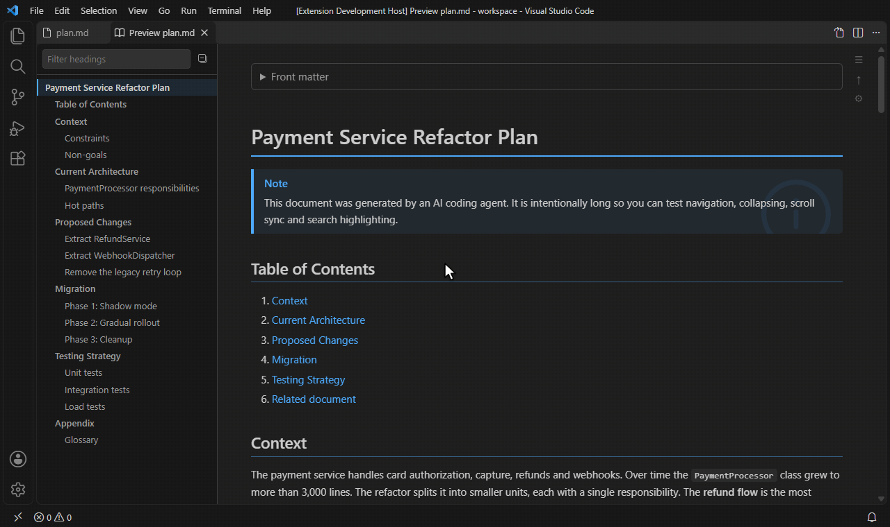
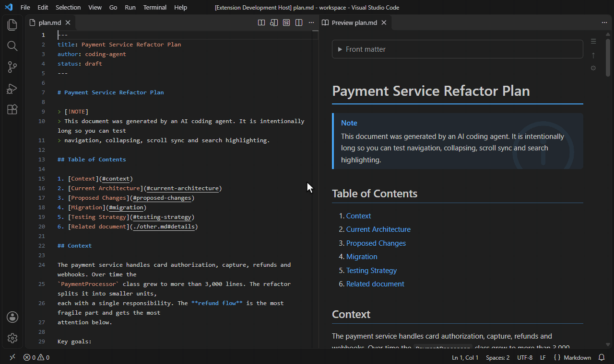
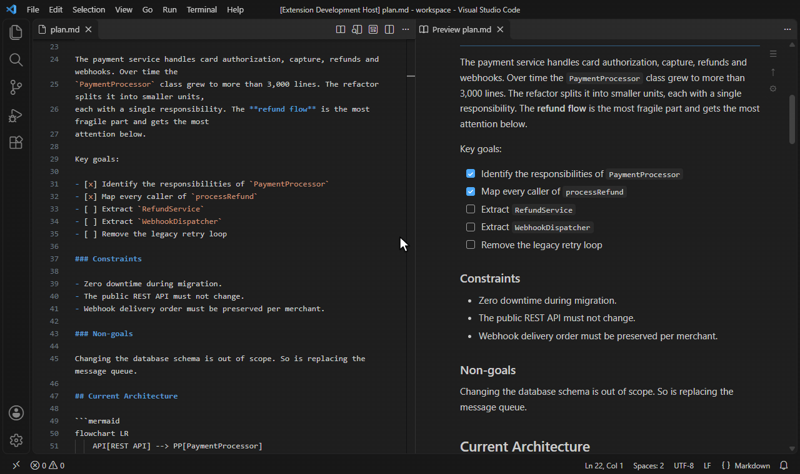
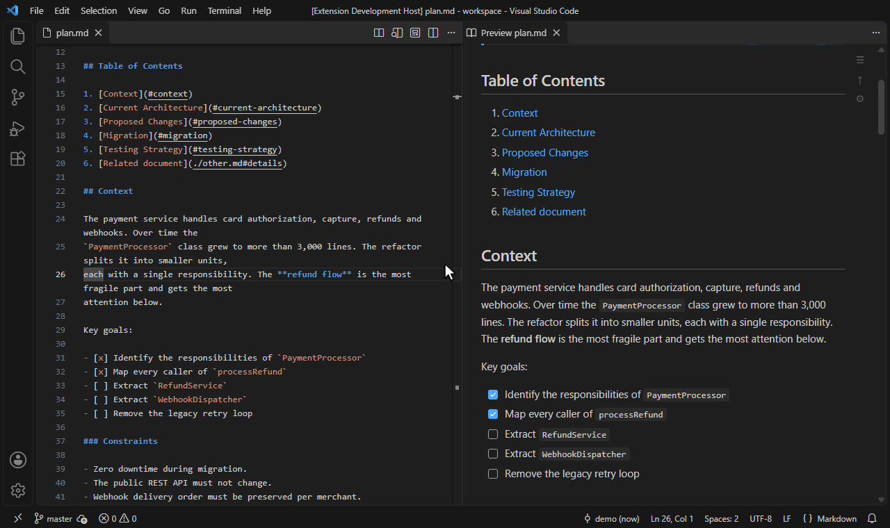
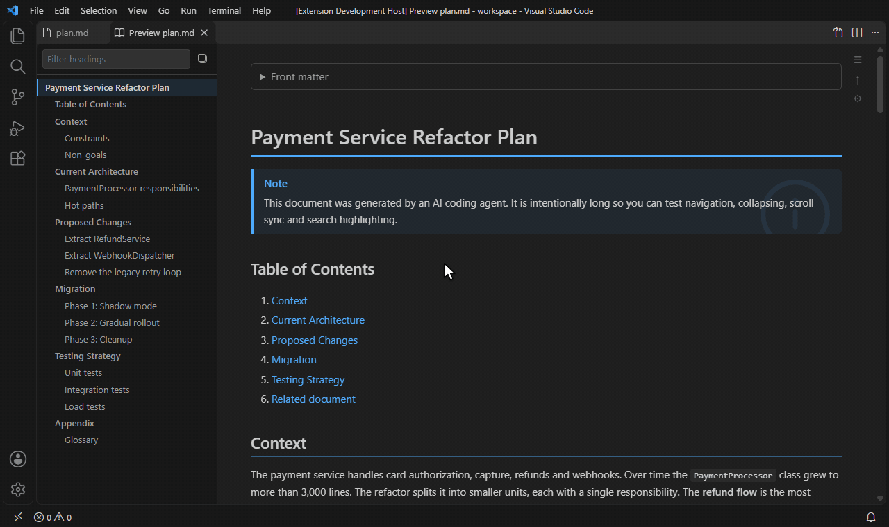

# Read Markdown

A reading-focused Markdown preview for VS Code, built for the long documents AI coding agents generate
(plans, specs, reports).



## Features

- **Quick navigation**: a sidebar outline of the document's headings. It has a filter box, highlights the section you are reading, and has buttons to collapse or expand everything. Drag its edge to resize it; the width is saved to `readMarkdown.nav.width` (double-click the edge to reset).
- **Collapsible sections**: fold the content under any heading with the chevron next to it. Folded sections are remembered while you edit.
- **Search highlight sync**: select text in the Markdown source, or step through matches with the Find widget (`Ctrl+F`, then `Enter`/`F3`). Every occurrence is highlighted in the preview, and it scrolls to the current match.
- **Scroll sync** between the source and the preview, in both directions.
- **Typography and colors**: theme presets (follow VS Code, light, dark, sepia, high contrast), body font, size, line height, content width, background and text colors, plus heading font, size, color and highlight style.
- **Custom CSS**, inline in settings or from files. Files are watched and reloaded live.
- **Quick settings panel** (⚙ in the preview) for the most common options. It writes your VS Code settings.
- **Code highlighting** with a copy button, **Mermaid diagrams**, GitHub alerts (`> [!NOTE]`), task lists, footnotes, front matter.
- **Live refresh**: the preview updates as you type, and also when the file changes on disk (e.g. an agent rewrites it).
- **Edit in the preview** (opt-in, `readMarkdown.edit.enabled`): fix a paragraph, list, table, code block or front matter without leaving the preview. See [Editing in the preview](#editing-in-the-preview).
- **Track changes against git**: for a git-tracked file, the preview shows what you have not staged yet, like Word's track changes: removed text struck through in red, added text in green, moved blocks double-struck in red where they were and double-underlined in green where they are now, joined by a yellow arrow, with change bars beside the text. See [Changes against git](#changes-against-git).



## Usage

| Action | How |
| --- | --- |
| Open preview | `Read Markdown: Open Preview` / book icon in the editor title |
| Open to the side | `Read Markdown: Open Preview to the Side` |
| Jump to source | Right-click a block → **Show Source**, ⠿ → **Show source** next to a block (edit mode), or `Read Markdown: Show Source` |
| Toggle outline | ☰ in the preview, or `Read Markdown: Toggle Quick Navigation` |
| Edit a block | ✎ next to a block or right-click → **Edit Block** (needs `readMarkdown.edit.enabled`), or double-click it if `readMarkdown.edit.doubleClick` is on |
| Reorder list items | Drag the ⠿ grip left of a bullet or checkbox, or focus it and press `Alt+↑` / `Alt+↓` (needs `readMarkdown.edit.enabled`) |

### Replacing the built-in preview

- `readMarkdown.preview.replaceDefault: true` makes `Ctrl+Shift+V` / `Ctrl+K V` open Read Markdown instead of the built-in preview.
- `readMarkdown.preview.autoOpen: "beside"` opens the preview automatically next to every Markdown file you open (`"active"` opens it in the same group).
- To open `.md` files *directly* in the preview, use **Reopen Editor With… → Read Markdown Preview**, or add:

  ```json
  "workbench.editorAssociations": { "*.md": "readMarkdown.editor" }
  ```

VS Code does not let extensions hide the built-in preview button, so it stays in the editor title bar.

### Editing in the preview

Turn on `readMarkdown.edit.enabled` (or **Edit blocks in preview** in the ⚙ panel). Then right-click a block and choose **Edit Block**, or hover it: a small toolbar appears in the left margin, with ✎ to edit the block's Markdown source in place and ⠿ for more block actions (such as **Show source**). On headings it sits to the left of the collapse arrow. The toolbar only appears in edit mode, so reading stays uncluttered.



To also open a block by double-clicking it, turn on `readMarkdown.edit.doubleClick` (**Double-click to edit** in the ⚙ panel). It is off by default because double-clicking normally selects a word.

- `Ctrl+Enter` (`Cmd+Enter` on macOS) or **Save** writes the block back to the document. `Esc` or **Cancel** discards your changes.
- List items can be reordered: hover an item and drag the ⠿ grip that appears left of its bullet or checkbox. The other items slide aside to show where it will land; `Esc` cancels. With the grip focused, `Alt+↑` / `Alt+↓` moves the item by one. Nested items and continuation lines move with their item, numbered lists keep their numbering, and one `Ctrl+Z` undoes the move. Items move within their own list only, and lists inside blockquotes cannot be reordered. If your system asks for reduced motion, a line marks the drop point instead of the animation.
- Task list checkboxes (`- [ ]`) become clickable: a click checks or unchecks the item in the source directly, without opening the block editor. Clicking the item text does not toggle it.
- You edit the raw Markdown of one top-level block. A list, table or blockquote is edited as a whole, and so is the front matter.
- The edit goes through VS Code's normal undo stack: `Ctrl+Z` in the source editor reverts it. The file is not saved unless `readMarkdown.edit.saveOnCommit` is on, or the file is not open in any editor (so an edit never sits in an unsaved buffer you cannot see).
- If the file changes while a block is open (you type in the source editor, or an agent rewrites the file), saving is refused. Copy your text, then cancel to reload the block.
- Read-only documents (e.g. Git history) cannot be edited.

### Changes against git

When a file is tracked by git and differs from its staged version (the git index, the same version the editor's gutter bars compare against), the preview marks the differences:

- Changed words: the old words struck through on red, the new ones on green.
- Added blocks or list items: green. Removed ones are shown in place, struck through on red.
- Moved paragraphs, list items and other blocks: double strikethrough in red where they were, double underline in green where they are now, and a yellow arrow in the left margin from the old place to the new one. Hovering either end outlines both and highlights the arrow; the ↑/↓ button beside it jumps there.
- Code blocks are compared line by line, tables cell by cell.
- A bar beside each change: green added, blue modified, red removed, green moved. The same marks appear on the scrollbar, like the editor's overview ruler, so you can see where the changes are in a long file.

Staging the file clears the marks; they come back for anything you change afterwards. Files that are untracked, ignored or outside a repository show no marks.



The ± button in the preview toolbar switches that preview between inline changes and bars only. `readMarkdown.changes.mode` sets the default: `inline`, `gutter` (bars only) or `off`. Removed text is shown for reference only: it is not part of the document, so it is skipped by search highlighting, the outline and block editing.

Clicking a changed file in the Source Control view still opens VS Code's own text diff, which extensions cannot replace. Open the file from the Explorer (or with **Read Markdown: Open Preview**) to see the changes in the preview.

### About search sync

VS Code does not expose the Find widget's text to extensions. Read Markdown mirrors the **editor selection** instead. Typing in the Find widget and pressing `Enter`/`F3` selects each match, so the preview follows along. Inside the preview you can also press `Ctrl+F` to use the webview's own find.

## Settings

All settings live under `readMarkdown.*`. Search "Read Markdown" in the Settings UI. Highlights:



| Setting | Default | Description |
| --- | --- | --- |
| `nav.show` / `nav.position` / `nav.maxDepth` / `nav.width` | `true` / `left` / `3` / `260` | Quick navigation |
| `theme.preset` | `vscode` | `vscode`, `light`, `dark`, `sepia`, `high-contrast` |
| `body.fontFamily`, `body.fontSize`, `body.lineHeight`, `body.maxWidth` | system, 15, 1.65, 860 | Body text |
| `body.backgroundColor`, `body.textColor` | preset | Colors |
| `headings.fontFamily`, `headings.scale`, `headings.fontSizes`, `headings.colors` | | Headings |
| `headings.highlight`, `headings.highlightColor` | `underline` | `none`, `underline`, `background`, `leftBorder` |
| `customCss.inline`, `customCss.files` | | Extra CSS |
| `search.syncSelection`, `search.caseSensitive`, `search.minLength` | `true`, `false`, `2` | Highlight sync |
| `search.highlightColor`, `search.currentHighlightColor` | theme | Match colors |
| `table.headerBackgroundColor`, `table.headerTextColor` | accent tint, body text | Table header colors |
| `sections.collapsible`, `sections.startCollapsedBelowLevel` | `true`, `0` | Folding |
| `code.copyButton`, `mermaid.enabled`, `preview.scrollSync` | `true` | Extras |
| `edit.enabled`, `edit.doubleClick`, `edit.saveOnCommit` | `false`, `false`, `false` | [Editing in the preview](#editing-in-the-preview) |
| `changes.mode` | `inline` | `inline`, `gutter`, `off`: [Changes against git](#changes-against-git) |

Example:

```json
"readMarkdown.theme.preset": "sepia",
"readMarkdown.body.fontFamily": "Georgia, serif",
"readMarkdown.headings.colors": { "h1": "#8b4513", "h2": "#a0522d" },
"readMarkdown.customCss.inline": ".rm-markdown p { text-align: justify; }"
```

Custom CSS can target `.rm-markdown` (content), `#rm-nav` (outline), `.rm-section`, `.rm-heading`, `pre.rm-code`, `.rm-edit` (the in-place block editor) and the `--rm-*` CSS variables. For changes against git: `ins.rm-ins` / `del.rm-del` (changed words), `.rm-chg-ins`, `.rm-chg-del`, `.rm-chg-mod`, `.rm-chg-move-from`, `.rm-chg-move-to` (blocks), `.rm-chg-bar` (bars), and the colors `--rm-chg-ins-bg`, `--rm-chg-del-bg`, `--rm-chg-del-line`, `--rm-chg-move`, `--rm-chg-move-arrow`, `--rm-chg-added`, `--rm-chg-modified`, `--rm-chg-deleted`.

## Development

```bash
npm install
npm run build        # bundle extension + webview into dist/
npm run watch        # rebuild on change
npm run check-types
npm test             # unit tests (mocha) + integration tests (VS Code test host)
npm run package      # build a .vsix
npm run demo:gifs    # re-record the README GIFs (needs ffmpeg; drives a real VS Code window)
```

Press `F5` to launch an Extension Development Host with `test/fixtures` open.

### Layout

- `src/extension.ts`: activation and commands
- `src/preview/`: webview panels, manager (sync, links, auto-open), HTML shell
- `src/render/`: markdown-it renderer (source map, headings, highlight.js, Mermaid, alerts)
- `src/config/`: settings, CSS variable generation, custom CSS loader
- `src/sync/selection.ts`: selection to search term logic
- `webview/`: preview UI (outline, sections, search highlight, scroll sync, settings panel)
- `media/preview.css`: preview styles

## License

GPL-3.0

The collapse-all / expand-all and alert icons are from [Codicons](https://github.com/microsoft/vscode-codicons) (CC BY 4.0).
