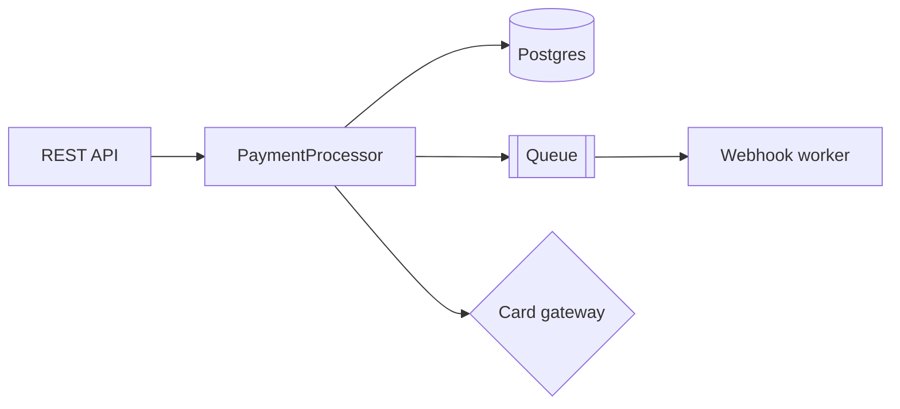
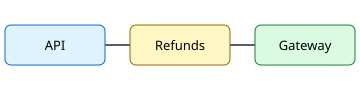

# Payment Service Refactor Plan

> [!NOTE]
> This document was generated by an AI coding agent. It is intentionally long so you can test
> navigation, collapsing, scroll sync and search highlighting.

## Table of Contents

1. [Context](#context)
2. [Current Architecture](#current-architecture)
3. [Proposed Changes](#proposed-changes)
4. [Migration](#migration)
5. [Testing Strategy](#testing-strategy)
6. [Related document](./other.md#details)

## Context

The payment service handles card authorization, capture, refunds and webhooks. Over time the
`PaymentProcessor` class grew to more than 3,000 lines. The refactor splits it into smaller units,
each with a single responsibility. The **refund flow** is the most fragile part and gets the most
attention below.

Key goals:

- [x] Identify the responsibilities of `PaymentProcessor`
- [x] Map every caller of `processRefund`
- [ ] Extract `RefundService`
- [ ] Extract `WebhookDispatcher`
- [ ] Remove the legacy retry loop

### Constraints

- Zero downtime during migration.
- The public REST API must not change.
- Webhook delivery order must be preserved per merchant.

### Non-goals

Changing the database schema is out of scope. So is replacing the message queue.

## Current Architecture



### PaymentProcessor responsibilities

| Responsibility      | Lines | Callers | Risk   |
| ------------------- | ----: | ------: | ------ |
| Authorization       |   640 |      12 | Medium |
| Capture             |   410 |       8 | Low    |
| Refund flow         |   920 |      15 | High   |
| Webhook dispatch    |   780 |       4 | Medium |
| Retry / idempotency |   350 |      21 | High   |

### Hot paths

The refund flow is called from three places: the merchant dashboard, the support tool and the
nightly reconciliation job. All three share the same retry loop.

```ts
export class PaymentProcessor {
  async processRefund(paymentId: string, amount: number): Promise<RefundResult> {
    const payment = await this.repo.find(paymentId);
    if (!payment) throw new NotFoundError(`payment ${paymentId}`);
    for (let attempt = 0; attempt < 3; attempt++) {
      try {
        return await this.gateway.refund(payment, amount);
      } catch (err) {
        if (!isRetryable(err)) throw err;
      }
    }
    throw new RetryExhaustedError('refund');
  }
}
```

## Proposed Changes

### Extract RefundService

`RefundService` owns validation, idempotency keys and gateway calls for the refund flow.

```python
def refund(payment_id: str, amount: int) -> RefundResult:
    """Refund part or all of a payment."""
    payment = repo.find(payment_id)
    if payment is None:
        raise NotFound(payment_id)
    return gateway.refund(payment, amount, idempotency_key=f"refund-{payment_id}")
```

#### Validation rules

1. Amount must be positive.
2. Amount must not exceed the captured amount minus previous refunds.
3. Currency must match the original payment.

#### Idempotency

Every refund request carries an idempotency key. Duplicate keys return the original result.

> [!WARNING]
> The legacy retry loop does **not** reuse idempotency keys. Removing it before `RefundService`
> ships could cause double refunds.

### Extract WebhookDispatcher

The dispatcher reads events from the queue and delivers them to merchant endpoints with
exponential backoff.

```json
{
  "event": "refund.succeeded",
  "payment_id": "pay_123",
  "amount": 1500,
  "currency": "USD"
}
```

### Remove the legacy retry loop

Once both services are live, delete the loop and the `RetryExhaustedError` type.

## Migration

### Phase 1: Shadow mode

Run `RefundService` in shadow mode next to the legacy path and compare results.

> [!IMPORTANT]
> Do not start Phase 2 until the shadow comparison reports zero mismatches for seven consecutive
> days.

### Phase 2: Gradual rollout

Route 1%, 10%, 50% then 100% of refund traffic to the new service.

```bash
./scripts/rollout.sh --service refund --percent 10
```

### Phase 3: Cleanup

Delete dead code and the shadow comparison job.

> [!CAUTION]
> Dropping the `legacy_refunds` table is irreversible. Take a snapshot and confirm the
> reconciliation job no longer reads from it first.

## Testing Strategy

### Unit tests

Cover each validation rule of the refund flow and the idempotency behavior.

### Integration tests

Exercise the gateway sandbox end to end, including webhook delivery.

### Load tests

Replay one day of production refund traffic at 3x speed.

> [!TIP]
> Select a word in the source editor (or use Ctrl+F and press Enter) and watch the preview
> highlight every occurrence, e.g. try **refund**.

## Appendix



Footnotes work too.[^1]

[^1]: Rendered with markdown-it-footnote.

### Glossary

- **Capture**: moving authorized funds.
- **Refund**: returning captured funds.
- **Idempotency key**: a unique token that makes retries safe.
