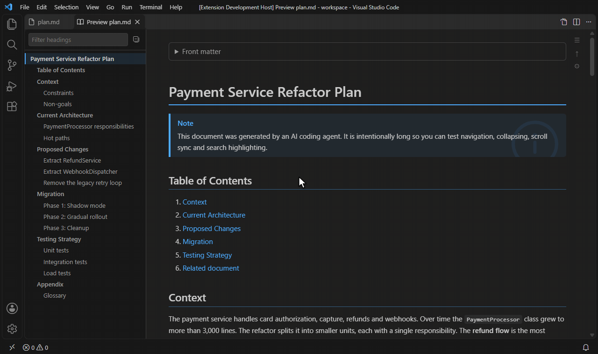

# Read Markdown

A reading-focused Markdown preview for VS Code, built for the long documents AI coding agents write: plans, specs, reports. Heading outline, collapsible sections, two-way scroll sync, search highlight sync, in-preview editing, track changes against git, Mermaid and syntax highlighting.

**[Install from the Marketplace](https://marketplace.visualstudio.com/items?itemName=huntertran.read-markdown)** · [README](https://github.com/huntertran/read-markdown#readme) · [Changelog](https://github.com/huntertran/read-markdown/blob/main/CHANGELOG.md) · [Issues](https://github.com/huntertran/read-markdown/issues)

## Pages

| Page | For |
| --- | --- |
| [Settings](Settings) | Every setting, with defaults and allowed values |
| [Keyboard and Mouse](Keyboard-and-Mouse) | Every shortcut and gesture in the preview |
| [Agent Workflows](Agent-Workflows) | Following an AI agent through a plan: the `[/]` convention and instructions for each agent |
| [Custom CSS](Custom-CSS) | Style hooks, variables and ready-made recipes |
| [FAQ](FAQ) | Common questions and fixes |
| [Security](Security) | What a document can and cannot do in the preview |
| [Contributing](Contributing) | Building, testing and how the code fits together |

The README covers the features and the basics of using them; these pages go into detail.
